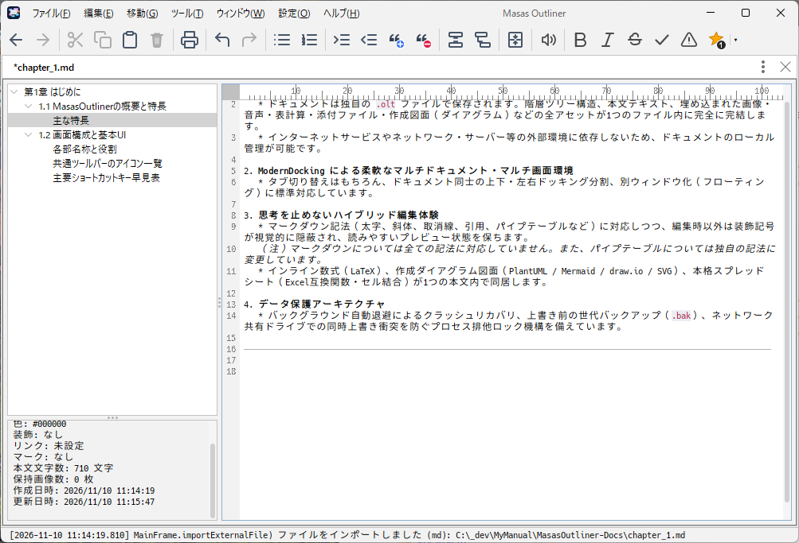
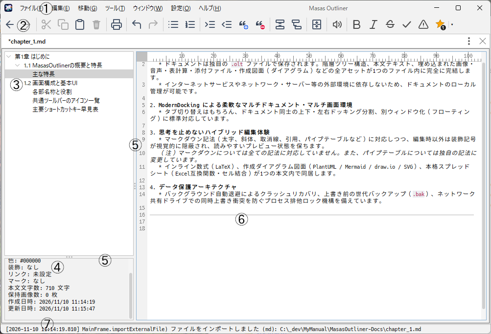
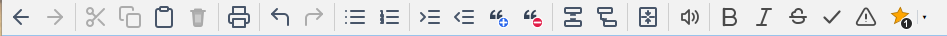

# 第1章 はじめに

## 1.1 MasasOutlinerの概要と特長

**MasasOutliner** は、思考の整理・文章執筆・情報集約をシームレスに行うために設計された、デスクトップ向けの本格的な**階層型思考プロセッサ（アウトライナー）** です。

ツリー構造によるアウトラインプロセッサの軽快な構造把握力と、リッチテキストエディタの柔軟な表現力を高次元で融合しています。

#### 主な特長

1. **完全ローカル完結**
   * ドキュメントは独自の `.olt` ファイルで保存されます。階層ツリー構造、本文テキスト、埋め込まれた画像・音声・表計算・添付ファイル・作成図面（ダイアグラム）などの全アセットが1つのファイル内に完全に完結します。
   * インターネットサービスやネットワーク・サーバー等の外部環境に依存しないため、ドキュメントのローカル管理が可能です。

2. **ModernDocking による柔軟なマルチドキュメント・マルチ画面環境**
   * タブ切り替えはもちろん、ドキュメント同士の上下・左右ドッキング分割、別ウィンドウ化（フローティング）に標準対応しています。

3. **思考を止めないハイブリッド編集体験**
   * マークダウン記法（太字、斜体、取消線、引用、パイプテーブルなど）に対応しつつ、編集時以外は装飾記号が視覚的に隠蔽され、読みやすいプレビュー状態を保ちます。  
   *（注）マークダウンについては全ての記法に対応していません。また、パイプテーブルについては独自の記法に変更しています。*
   * インライン数式（LaTeX）、作成ダイアグラム図面（PlantUML / Mermaid / draw.io / SVG）、本格スプレッドシート（Excel互換関数・セル結合）が1つの本文内で同居します。

4. **データ保護アーキテクチャ**
   * バックグラウンド自動退避によるクラッシュリカバリ、上書き前の世代バックアップ（`.bak`）、ネットワーク共有ドライブでの同時上書き衝突を防ぐプロセス排他ロック機構を備えています。

---

## 1.2 画面構成と基本UI

MasasOutliner のメイン画面は、作業効率を最大化する機能的なパネルレイアウトで構成されています。

#### 各部名称と役割

| 番号 | 構成要素 | 説明 |
| :---: | :--- | :--- |
| **①** | **メニューバー** | ファイル操作、編集、移動、ツール、ウィンドウ、設定、ヘルプの全機能へアクセスします。 |
| **②** | **共通ツールバー** | よく使うコマンド（戻る/進む、クリップボード、印刷、元に戻す/やり直し、リスト、インデント、引用、分割、結合、音声バー、文字・ノード修飾）がワンクリックで実行できます。 |
| **③** | **ツリービュー (左上)** | ドキュメントの階層構造（アウトライン）を一覧表示します。ドラッグ＆ドロップによるノード並び替え、外部ファイルの子ノード一括挿入に対応します。 |
| **④** | **ノード属性パネル (左下)** | 選択中ノードの名称、カラー、スタイル、リンク先、ステータスマーク、本文文字数、保持画像数、作成日時・更新日時を表示します。 |
| **⑤** | **スプリットバー (境界線)** | ツリーとエディタの横幅比率、ツリーと属性パネルの上下比率をマウスドラッグで自由に変更できます。 |
| **⑥** | **テキストエディタ (右側)** | 選択したノードの本文を記述・閲覧するリッチエディタです。左端に行番号、上端に文字数ルーラを備えています。 |
| **⑦** | **ステータスバー (最下部)** | アプリケーションの動作状況、検索・置換結果、処理ログメッセージ、タイムスタンプをリアルタイムに表示します。 |

#### 共通ツールバーのアイコン一覧

共通ツールバーには、編集効率を高めるボタンが機能グループごとに配置されています。

* **履歴ナビゲーション**: 「戻る (Alt+←)」「進む (Alt+→)」
* **クリップボード**: 「切り取り (Ctrl+X)」「コピー (Ctrl+C)」「貼り付け (Ctrl+V)」「削除 (Delete)」
  * ※ツリー選択時はノードを対象とし、エディタ選択時はテキストを対象として自動ディスパッチされます。
* **印刷**: 「印刷 (Ctrl+P)」
* **履歴復元**: 「元に戻す (Ctrl+Z)」「やり直し (Ctrl+Y)」
* **リスト操作**: 「箇条書き(・)」「連番(1.)」「インデント追加(＋)」「インデント削減(ー)」「引用追加(Q)」「引用解除(W)」
* **ノード分割・結合**: 「カーソル位置で分割(同レベル)」「カーソル位置で分割(子ノード)」「ノード結合(M)」
* **音声バー表示切替**: 「音声コントロールツールバーの表示/非表示(A)」
* **修飾・マーク**: 
  * 「太字」「斜体」「取消線」:
    ※ ノード選択時は、ノード名を変更します。
    ※ テキスト選択時は、選択範囲のマークダウン装飾（`**`、`*`、`~~`）に自動連動します。
  * 「チェック(✔)」「重要(⚠)」: ノード名の左にアイコンが付加されます。
  * 「スター(★)」: ノード名の左に指定された色の★アイコンが、指定された数 付加されます。 
    ※ 押下後の未来状態（点灯/消灯）を動的にプレビュー表示。右側の「▾」ボタンから個数（0〜3個）と色を即座に変更可能。

#### 主要ショートカットキー早見表

| ショートカット | 機能 |
| :--- | :--- |
| `Ctrl + N` | 新規ドキュメントの作成 |
| `Ctrl + O` | ドキュメントを開く |
| `Ctrl + S` | 上書き保存 |
| `Ctrl + Shift + S` | 名前を付けて保存 |
| `Ctrl + P` | 印刷ダイアログの表示 |
| `Ctrl + Z` | 元に戻す（エディタ本文 / ツリー操作） |
| `Ctrl + Y` / `Ctrl + Shift + Z` | やり直し |
| `Ctrl + F` | 検索ツールバーの表示 |
| `Ctrl + H` | 置換ツールバーの表示 |
| `F3` / `Shift + F3` | 次を検索 / 前を検索 |
| `Alt + S` | 検索時、現在のノードをスキップして次ノードへジャンプ |
| `Ctrl + Shift + F` | マークダウン表の幾何学的自動整形 |
| `Ctrl + A` | 本文の全選択 |
| `Esc` | 検索バーの非表示 / 入力のキャンセル |
| `Alt + ←` / `Alt + →` | 過去に選択したノードへ戻る / 進む |
| `F2` | 選択ノードのインライン名前変更 |
| `F1` | 公式オンライン操作マニュアル（Web）を開く |
| `Ctrl + マウスホイール` | 本文内画像・図面・表の表示倍率拡大/縮小 |

