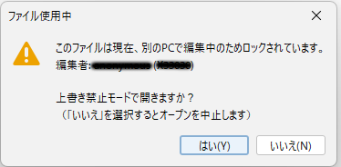
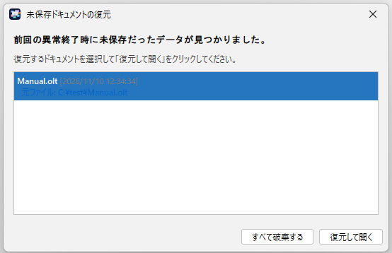
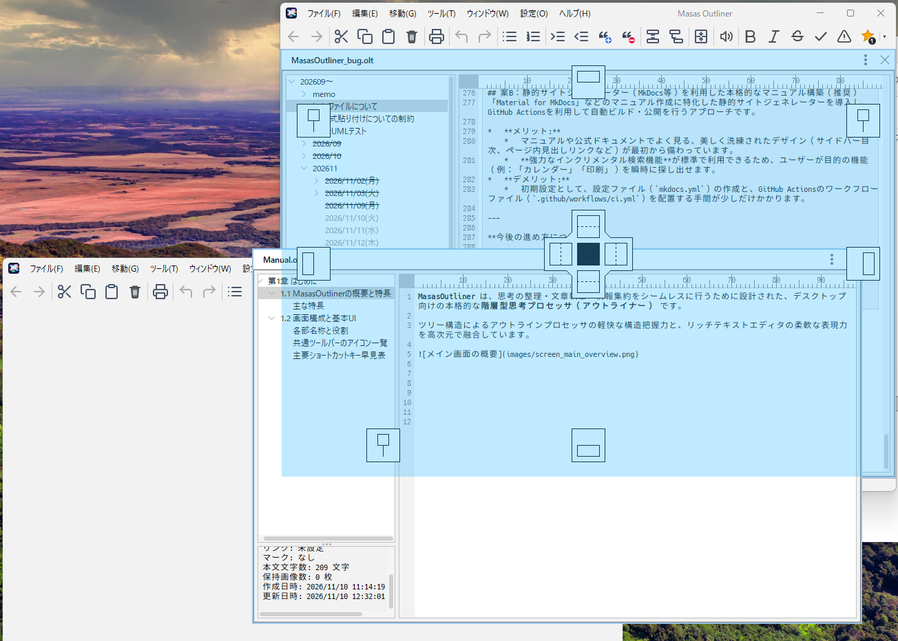
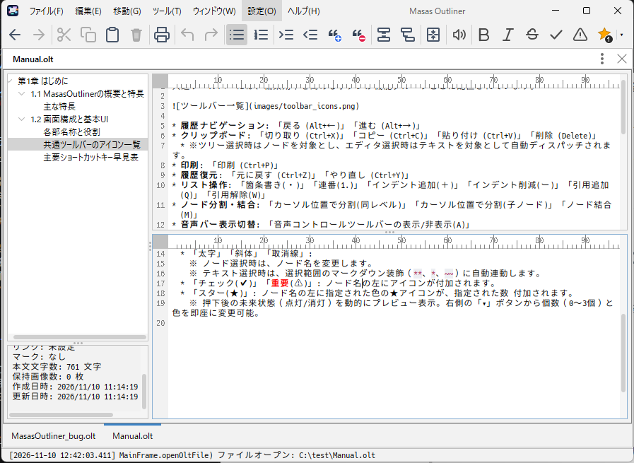

# 第2章 ファイルとウィンドウの基本操作

## 2.1 新規作成・開く・保存

#### 新規作成 (`Ctrl + N`)
* メニューバーの **[ファイル] → [新規(N)]** を選択するか、`Ctrl + N` を押します。
* 「新規 1」「新規 2」といった連番タイトルの空ドキュメントタブが中央の作業領域に即座に生成されます。

#### ファイルを開く (`Ctrl + O`)
* メニューバーの **[ファイル] → [開く(O)...]** を選択するか、`Ctrl + O` を押します。
* OS標準のファイルダイアログが表示されます。拡張子 `.olt` のファイルを選択してください。
* **重複オープンの防止**: すでに別のタブやウィンドウで開かれているファイルを再度開こうとした場合、新規読み込みは行われず、既存のタブへ自動的にフォーカスが切り替わります。

#### 上書き保存 (`Ctrl + S`) と安全なファイル保護
* 編集中のドキュメントは、タブのタイトルの先頭に `*` マーク（例: `*設計メモ.olt`）が表示されます。
* メニューの **[ファイル] → [上書き保存(S)]** または `Ctrl + S` を実行すると変更が確定し、`*` が消えます。

##### 上書き前の世代バックアップ (`.bak`)
* 設定で「上書き保存時にバックアップファイル (.bak) を作成する」が有効になっている場合（初期設定: ON）、上書き前の状態が同名で `filename.olt.bak` として自動退避されます。万一の誤操作時でも直前の状態を取り戻せます。

#### 名前を付けて保存 (`Ctrl + Shift + S`)
* 新規作成したドキュメントを初めて保存する場合、または既存ファイルを別名で保存したい場合は、**[ファイル] → [名前を付けて保存(A)...]** を選択します。
* ファイル名入力時に拡張子 `.olt` を省略しても、自動的に付与されて保存されます。

#### 最近使用したファイル（履歴機能）
* **[ファイル] → [最近使用したファイル(R)]** サブメニューから、過去に開いたドキュメントをすばやく再オープンできます。
* メニューには `1: 〜`、`2: 〜` と番号が振られており、数字キーでのクイックオープンに対応します。
* 保持件数は環境設定から変更可能です（0〜15件、デフォルト: 5件）。実在しない（削除・移動された）ファイルは自動的にリストから除外されます。

---

## 2.2 ファイルの排他制御と編集モード

MasasOutliner は、ネットワーク共有フォルダ（NAS、ファイルサーバーなど）や複数ウィンドウ起動時において、複数人または複数プロセスによる同時上書き・データ先祖返りを防止する排他制御を搭載しています。

#### 隠しロックファイル（`.~ファイル名.olt.lock`）
ドキュメントを開くと、そのファイルと同じフォルダ内に `.~ドキュメント名.olt.lock` という隠しファイルが自動生成されます。

#### 競合発生時の自動判定ロジック

ファイルを開こうとした際、すでにロックファイルが存在する場合、システムは状況を自動判別してダイアログを表示します。

1. **同一PC内の別プロセス（別ウィンドウ）で開かれている場合**
   * OSのプロセスリストを参照し、該当PIDが現在も生存しているかを判定します。
   * 生存している場合: 「別プロセスで開かれています」と警告が表示され、[上書き禁止モードで開く] または [キャンセル] を選択します。
   * プロセスがすでに終了している場合（以前の強制終了の残骸など）: 自動的に安全と判断され、待たされることなくロックを引き継いで通常オープンします。

2. **別のPCで開かれている場合**
   * **現在進行形で編集中**: ハートビート（30秒間隔の生存報告）が継続しているため、ファイルが保護されます。編集者名とPC名が表示され、[上書き禁止モードで開く] か [キャンセル] を選択できます。
   * **ロックの有効期限切れ（2分以上更新なし）**: 相手のPCがスリープしたか異常終了したと判断されます。「ロックを解除して開く（上書き許可）」「上書き禁止モードで開く」「キャンセル」の選択肢が提示され、業務の停滞を防ぎます。

#### 上書き禁止モードの挙動
* ロックの取得を行わずにファイルを開いた場合、ドキュメントは**上書き禁止モード**となります。
* タブには `[上書き禁止]` というバッジが表示されます。
* 編集自体は自由に行えますが、元ファイルを破壊しないよう `Ctrl + S`（上書き保存）はブロックされ、自動的に「名前を付けて保存」ダイアログが起動します。

---

## 2.3 クラッシュリカバリ（自動バックアップと復元）

作業中の突然の停電、OSの強制再起動、予期せぬクラッシュに備え、編集中のデータをバックグラウンドで定期退避する**自動クラッシュリカバリ機構**が稼働しています。

#### バックグラウンド自動退避の仕組み
* 設定されたインターバル（初期値: 3分間隔、1〜30分で変更可能）ごとにバックアップが行われます。
* **UIフリーズの完全防止**:
  * 編集内容に変更があるタブが存在する場合のみバックアップを行います。
  * フリーズの対策として、バックアップの主要な処理は独立したバックグラウンドで実行されます。
* 退避データは `%LOCALAPPDATA%\MasasOutliner\recovery` に安全に保管されます。
* ユーザーが手動で通常保存を完了するか、タブを正常に閉じた時点で、該当ドキュメントのバックアップデータは自動消去されます。

#### 起動時の未保存データ復元ダイアログ

異常終了した後に MasasOutliner を起動すると、スプラッシュスクリーンの直後に自動的に復元ダイアログが表示されます。

* **残骸の自動判定**: 別プロセスで現在進行形に編集中のバックアップファイルは除外され、本当に異常終了したデータのみが一覧に抽出されます。
* **復元して開く**: 選択したドキュメントが新規タブとして復元されます。元ファイルが存在していたものは元のパス・タイトルが復元され、未保存だったものは「無題」の未保存（`*`）状態でエディタに蘇ります。
* **すべて破棄する**: 不要なバックアップ残骸を一括削除し、初期状態からクリーンに起動します。

---

## 2.4 ウィンドウ配置とマルチ画面活用

MasasOutliner はドッキングフレームワーク（ModernDocking）を採用しており、作業環境やディスプレイ構成に合わせた自由自在なウィンドウレイアウトが可能です。

#### ドッキングとタブ化
* **タブ化**: パネルのタイトルバーを別のパネルの中央付近へドラッグすると、タブとしてグループ化されます。
* **上下・左右分割**: タイトルバーをパネルの上下左右の端付近へドラッグすると、半透明のドッキングガイドが表示され、画面を分割して並列配置できます。

#### フローティングウィンドウ（画面の分離）
* パネルのタイトルバーをメインウィンドウの外へドラッグするか、ヘッダー右上のドットが縦に三点並んだアイコンから **[ウィンドウへ切り替え]** を選択すると、独立したフローティングウィンドウ（`Floating Frame`）に分離します。
* マルチディスプレイ環境において、一方の画面に資料アウトラインを表示し、もう一方の画面でメインの執筆を行うといった快適な作業が可能です。
* フローティングウィンドウにも専用のメニューバーとツールバーが自動付与されるため、どの画面上でも同一の操作性を維持できます。

#### パネルの全面表示（最大化）と安全ガード
* ヘッダー右上の縦三点アイコンから **[全面表示]** をクリックすると、そのパネルがウィンドウ全体に広がる**全面表示モード**になります。
* 全面表示中はヘッダーに **[全面表示中]** インジケータが点灯します。
* **レイアウト破壊防止ガード**: 全面表示中に誤って別のドキュメントを開いたり、ウィンドウを不用意にドラッグしてレイアウトが崩れるのを防ぐため、一部の操作（ウィンドウドラッグ、別ファイルのオープン、新規作成等）に安全ガードが掛かります。元に戻すアイコンをクリックすることで即座に元の分割レイアウトへ復帰します。

---

## 2.5 エディタの上下分割表示

1つの長いドキュメントを執筆している際、「過去の記述やプロットを参照しながら、下部で最新の章を執筆したい」という場面に最適なのが**エディタの上下分割表示**です。

#### 分割の開始と解除
* テキストエディタ上で右クリックし、コンテキストメニューから **[エディタを上下に分割]** を選択します。
* エディタ領域が上下2段に分割され、下側にも独立した行番号・文字数ルーラを持つサブエディタが出現します。
* 分割を解除したい場合は、右クリックメニューから **[エディタの分割を解除]** を選択するか、中央の仕切り線（スプリッター）を上端または下端までドラッグすることで自然に1画面へ戻ります。

#### 完全連動編集（同一ドキュメントの共有）
* 上下のエディタは独立したスクロール位置・カーソル位置を保持できますが、編集対象のドキュメントモデル（`StyledDocument`）は完全に共有されています。
* 上側で文字を入力・編集すると、下側の該当箇所にもリアルタイムに反映されます。画像、音声、表計算などのリッチメディアも双方で正しく同期描画されます。
* 分割状態はノードごとに記憶されるため、別のノードへ移動して戻ってきても前回の分割状態が維持されます。

